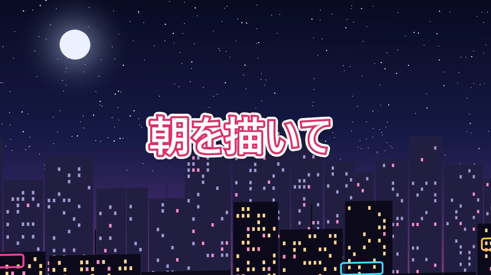

# KTR_LyricMV

歌詞アニメーションのミュージックビデオを作る Windows 用の無料ソフトです。
曲を読み込み、拍に合わせて歌詞を並べ、文字の見た目と動きを付けて MP4 に書き出せます。

<a href="https://ktr-shibata.github.io/KTR_LyricMV-releases/"></a>

## ダウンロード

### **[▶ 紹介とダウンロードのページへ](https://ktr-shibata.github.io/KTR_LyricMV-releases/)**

できることの紹介・はじめかた・動作環境・よくある質問は、上のページにまとめています。

### **[▶ Microsoft Store で入手（無料）](https://apps.microsoft.com/detail/9n5tg2zct045?hl=ja-JP&gl=JP)**

ふつうはストア版を入れてください。Microsoft の署名付きで、ストアで更新されます。

ストアが使えない PC では、[最新版のリリース](https://github.com/KTR-Shibata/KTR_LyricMV-releases/releases/latest) から
`KTR_LyricMV-<版>-setup.exe`（インストーラー）を選びます。手動インストールする場合は `KTR_LyricMV-<版>-win-x64.zip` です。
中身はストア版と同じです（新しい版は、ストアの審査があるぶん、ストア版のほうが数日遅れて届くことがあります）。
「Source code」は開発用のファイルなので、ダウンロードする必要はありません。

## 動作環境

- Windows 10 / 11（64 ビット）。.NET は同梱しているので、別のインストールは不要です
- 動画の書き出しと動画素材の読み込みには [ffmpeg](https://ffmpeg.org/download.html) が必要です（同梱していません。入れ方は使い方ガイドに）
- JIZURA レイヤーには Microsoft Edge WebView2 ランタイム（Windows 11 には最初から入っています）、
  読み上げて並べるには [VOICEVOX](https://voicevox.hiroshiba.jp/) が必要です（使うときだけ）

<details>
<summary>インストーラー版・zip 版をはじめて起動するとき・ファイルの確かめ方</summary>

インストーラー版と zip 版はコード署名をしていないため「Windows によって PC が保護されました」と表示されることがあります。
「詳細情報」→「実行」で起動できます。

ダウンロードしたファイルが本物かどうかは、各リリースに載せている SHA-256 と照らし合わせて確かめられます。

```
certutil -hashfile KTR_LyricMV-<版>-setup.exe SHA256
```

</details>

<details>
<summary>同梱ソフトウェア</summary>

.NET、SkiaSharp（Skia）、NAudio、OpenTK、[JIZURA](https://github.com/852wa/JIZURA)（hakoniwa、MIT License）、
[KanjiVG](https://kanjivg.tagaini.net/) のデータ（CC BY-SA 3.0）、Microsoft.Web.WebView2 を同梱しています。ライセンス表記は、
ダウンロードしたファイルの中の `THIRD-PARTY-NOTICES.txt` をご覧ください。

</details>

<details>
<summary>禁止事項 / Prohibited acts</summary>

本ソフトウェア（KTR_LyricMV と組み立てツール。同梱のオープンソースソフトウェアを除きます）について、次のことを禁止します。

- リバースエンジニアリング、逆コンパイル、逆アセンブル、そのほかの方法でプログラムを解析すること
- 改変すること、改変したものを配布すること
- 作者の許可なく、再配布・販売・貸与すること（ダウンロードページの紹介やリンクは自由です）

ただし、法令によって認められる行為は除きます。同梱のオープンソースソフトウェア（JIZURA など）は、それぞれのライセンス（`THIRD-PARTY-NOTICES.txt`）に従います。
本ソフトウェアで作った動画やプロジェクトは、この禁止事項の対象ではありません。

The following are prohibited for this software (KTR_LyricMV and its builder tool, excluding the bundled open-source software):

- Reverse engineering, decompiling, disassembling, or otherwise analyzing the program
- Modifying it, or distributing modified versions of it
- Redistributing, selling, or lending it without the author's permission (introducing or linking to the download page is welcome)

This does not apply to acts permitted by applicable law. The bundled open-source software (such as JIZURA) is governed by its own license (see `THIRD-PARTY-NOTICES.txt`).
Videos and projects you make with this software are not subject to these restrictions.

</details>

<details>
<summary>免責事項</summary>

本ソフトウェアは無償で提供するもので、動作・品質・特定の目的への適合性などについて、いかなる保証もいたしません。
本ソフトウェアの使用または使用できなかったことによって生じたいかなる損害（データの消失、プロジェクトや作成した動画の
破損、パソコンの不具合などを含みます）についても、作者は一切の責任を負いません。ご利用は利用者ご自身の責任でお願いします。

This software is provided free of charge, "as is", without warranty of any kind. The author accepts no liability
for any damage arising from its use or inability to use it, including loss of data or damage to projects or videos.
Use it at your own risk.

</details>
